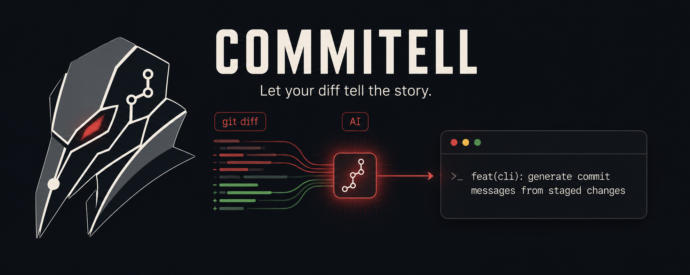

# commitell

[](LICENSE)

`commitell` turns Git changes into DCO-signed commits with OpenAI or deterministic
local messages. Its `cmt` alias also shows the status and dependencies of your
local repositories. Both workflows use readable, colored terminal output.

[Quick start](#quick-start) · [Options](#options) · [Colors](#colors) ·
[Install](#install) · [Repository overview](#repository-overview) ·
[Development](#development)

## Quick start

Preview a local commit message without an API key or model request:

```sh
commitell --offline --dry-run
```

Remove `--dry-run` to commit. With no selection options, commitell includes the
complete dirty working tree. To use OpenAI instead:

```sh
export COMMITELL_API_KEY="<your OpenAI API key>"
commitell
```

Inspect repositories without changing them:

```sh
cmt -tF ~/code
cmt -tGF ~/code
```

Select, split, and publish changes when needed:

```sh
commitell --staged --exclude "broken.txt,generated.json"
commitell --split --model gpt-6-luna --dry-run
commitell --split --push --pr --base main
commitell --push --force --base main
```

Commitell uses OpenAI directly at `https://api.openai.com/v1` and defaults to
`gpt-6-luna`. There is no provider selector or configurable API URL.

## Options

Run `commitell --help` for grouped options and examples, or `cmt -t --help` for
the repository overview.

| Option | Short | Behavior |
| --- | --- | --- |
| `--staged` | `-s` | Commit only content already in the Git index. |
| `--exclude FILES` | `-x` | Exclude exact repository-relative paths; repeat or separate with commas. |
| `--split` | `-c` | Ask the model for up to eight commits, keeping whole files and renames together. |
| `--model MODEL` | `-m` | Repeat to set the complete model fallback order; `--solver` is an alias. |
| `--offline` | `-o` | Generate a local Conventional Commit message without an API key. |
| `--dry-run` | `-d` | Show complete messages, selected files and publishing plans without changing Git. |
| `--push` | `-p` | Push the current branch after all commits succeed. |
| `--pr` | `-P` | Push and create a draft pull request with GitHub CLI. |
| `--remote NAME` | `-r` | Select the publishing remote (default: `origin`). |
| `--base BRANCH` | `-b` | Declare the protected default and pull-request base branch. |
| `--force` | `-f` | Skip likely-secret confirmation and use `git push --force-with-lease`. |
| `--color WHEN` | | Choose `auto`, `always` or `never`. |
| `--version` | `-v` | Print the installed version. |
| `--help` | `-h` | Show help without an API request. |

Exclusions do not support globs or filenames containing commas. `--offline`
cannot be combined with model selection or `--split`. `--force` is required to
push the default branch and can send possible secrets to the model; review
the selected diff before using it.

Boolean short options can be clustered, so `commitell -scd` is equivalent to
`commitell --staged --split --dry-run`. Value-taking options such as `-m`
must be separate or last in a cluster.

If a changed file cannot safely be read, commitell stops and names the file.
When the local scanner finds a possible secret, commitell shows only its
location and detection type, then asks before any model request or staging:

```text
Continue anyway? [y/N]
```

Answer `y` to proceed. Answer `n` or press Enter to cancel without staging or
sending the content. Non-interactive runs fail closed; review the finding and
use `--exclude` or the explicit `--force` override. Matched secret values are
not printed, and files are never excluded automatically. This warning flow also
covers harmless fixtures such as test values in `flake.nix`.

## Colors

Help, previews, success messages, warnings, errors and repository overviews use
the same color policy. Cyan highlights commands and plans, green signals
success, yellow marks warnings, and red marks errors. Status text remains
meaningful with colors disabled.

| Mode | Behavior |
| --- | --- |
| `--color auto` | Default. Color each terminal stream independently; honor non-empty `NO_COLOR` and `TERM=dumb`. |
| `--color always` | Force ANSI colors, including in pipes; override the environment. |
| `--color never` | Disable ANSI colors. |

```sh
commitell --color always --help
commitell --color never --offline --dry-run
cmt -tGF --color always ~/code
NO_COLOR=1 commitell --help
```

Put `--color` before `--help`; in overview mode, put it after `-t` or `tree`.
Redirected output is plain in auto mode. JSON and `--version` always stay plain,
and formatting never becomes part of a generated commit message.

## Models and privacy

`COMMITELL_API_KEY` supplies the OpenAI key. `COMMITELL_MODELS` accepts a
comma-separated fallback order; repeated `--model` (or `--solver`) flags replace
that order. The default is `gpt-6-luna`. Luna requests set `reasoning_effort` to
`none` for short commit messages and use `max_completion_tokens` for the output
budget. See [OpenAI's Luna documentation](https://developers.openai.com/api/docs/models/gpt-6-luna).

Selected changes are sent directly to OpenAI under the account's data policies.
Commitell does not assert Zero Data Retention or EU routing. The former
OpenRouter/OpenCode providers, arbitrary API URLs, and `--models`, `--auto-model`,
and `--eu` flags have been removed. Legacy provider, URL, and provider-specific
key environment variables are ignored; they cannot redirect requests or supply
the OpenAI key.

`commitell --offline` creates the message from local file status, makes no model
API request, and needs no key. Explicit `--push` or `--pr` still publishes to the
configured Git remote. If every configured model fails, Commitell stops before
staging; offline mode remains available.

The local scanner flags common secret filenames and token patterns for
confirmation, omits binary contents, and bounds the outbound diff and recent
commit subjects. It is not a complete secret-management system. `--force`
bypasses the local likely-secret confirmation; review the selected content
before using it.

## Install

Requires Go 1.26+ and Git:

```sh
go install github.com/timfewi/commitell@latest
```

Published releases are tagged with semantic versions. Check an installation
without making an API request:

```sh
commitell --version
```

Or build the current checkout:

```sh
go build .
```

### Nix

Run it without installing anything:

```sh
nix run github:timfewi/commitell
```

Append a published tag such as `/v0.2.0` for a reproducible version. The flake
declares `packages.default` and `devShells.default` for `x86_64-linux`,
`aarch64-linux`, and `aarch64-darwin`. To install it from a NixOS or
home-manager config, add the input and reference the package in a module that
receives `inputs`:

```nix
# flake.nix
inputs.commitell = {
  url = "github:timfewi/commitell";
  inputs.nixpkgs.follows = "nixpkgs";
};

# any module with `inputs` in scope
environment.systemPackages = [
  inputs.commitell.packages.${pkgs.stdenv.hostPlatform.system}.default
];
```

Except in `--offline` mode, `commitell` reads `COMMITELL_API_KEY` from the
environment. Do not put the key in a Nix expression — string literals end up
world-readable in `/nix/store`.
Wrap the package instead and read the secret at runtime, for example from
[agenix](https://github.com/ryantm/agenix):

```nix
pkgs.writeShellApplication {
  name = "commitell";
  runtimeInputs = [ pkgs.git pkgs.coreutils ];
  text = ''
    COMMITELL_API_KEY="$(cat ${config.age.secrets.openai-api-key.path})" \
      exec ${inputs.commitell.packages.${pkgs.stdenv.hostPlatform.system}.default}/bin/commitell "$@"
  '';
}
```

## Behavior

Before changing the index, `commitell`:

- rejects merge conflicts and in-progress Git operations;
- checks `user.name` and `user.email`;
- scans the outbound text for likely secrets and asks before proceeding;
- generates and validates a subject with an optional body;
- verifies that the working tree did not change during analysis.

With no selection options it then runs the equivalent of:

```sh
git add -A
git commit -s -m "<subject>" -m "<optional body>"
```

Normal Git hooks remain active. Selective and split commits use a temporary Git
index so excluded or unrelated staged changes remain untouched. If a later
split commit fails, earlier split commits remain in history and commitell
reports how many groups completed; it never discards the remaining working-tree
or index content.

Publishing is deliberately explicit. It refuses detached HEAD and refuses the
declared or detected default branch unless `--force` is supplied. With that
flag it uses Git's safer `--force-with-lease` mode; it never creates a branch.
PR preflight checks `gh auth status`; commitell then pushes itself and invokes
`gh pr create --draft --fill` with explicit base and head branches.

## Development

Use `devenv shell` for the native default environment, or `devenv shell -- <command>`
for one command. `devenv.nix` reuses the default Flake shell, including its compiler,
build inputs and hooks; `flake.lock` remains the project toolchain pin.
`devenv.yaml` and `devenv.lock` pin the native 2.4.0 runtime separately.
After owner-managed shell-hook activation, review the configuration and explicitly
run `devenv allow` only if you want automatic entry. `nix develop .` and existing
named Flake shells remain available. The bridge uses Git-filtered source: new
source files must be reviewed and Git-tracked before evaluation; never use
`path:.` to copy ignored state into the Nix store. `.devenv/` is local ignored state.

Make remains the authoritative build interface:

```sh
project-check fast
project-check full
```

The workspace checks run `make check` and `make nix-check` in the pinned Nix
development shell. For direct use, run `nix develop . --command make check`;
the race-enabled Go tests require a C compiler. The Nix gate evaluates all
three declared systems and builds the current system's package.

The Justfile provides short, discoverable wrappers for local development:

```sh
just --list
just check
just help
```

With Nix, `nix develop` provides Go, gopls, Git, GitHub CLI, Make, Just, nixfmt,
deadnix, and statix; `nix build` runs the tests as part of the build and wraps
the installed program with its `git` and `gh` runtime dependencies.
Editors supporting Dev Containers can open `.devcontainer/devcontainer.json`
for an equivalent Go 1.26 environment.

Contributions are welcome. See [CONTRIBUTING.md](CONTRIBUTING.md) for the
project rules and [CHANGELOG.md](CHANGELOG.md) for user-facing changes.
Maintainers can use [RELEASE.md](RELEASE.md) for the release and
Nixpkgs submission checklist.

## Repository overview

The package also installs `cmt`. Use `cmt -t` to inspect repositories without
an API key or model request:

```sh
cmt -tF ~/code       # changed files
cmt -tG ~/code       # dependency graph and Git status
cmt -tA ~/code       # include clean repositories
cmt -tGF ~/code      # graph with changed files
cmt -tG --json ~/code
```

Put `-t` first to select the overview. `F`, `G`, and `A` can be combined in
that cluster or passed separately (`cmt -t -F -G`). `cmt tree --files`,
`cmt tree --graph`, and `cmt tree --all` remain available. Use `cmt -t --help`
for all overview options.

The directory view shows repositories with changes or locally known ahead/behind
status. `--all` includes clean repositories. Each repository line shows its
branch, a differing upstream, `↑`/`↓` ahead/behind counts and a change summary
(staged, unstaged, untracked, conflicts). Directories that lead to a single
entry collapse into one path. `--files` lists changed paths in Git's short
status format; `--max-files N` bounds each list (zero means all). `--depth N`
bounds discovery. Linked worktrees and nested repositories are included;
dependency/cache folders and directory symlinks are skipped. No fetch or
repository code is executed.

The graph shows **consumer ─▶ input** edges by matching direct `flake.lock`
inputs to the discovered repositories' origin URLs. Each repository without a
local consumer starts a tree; an input reached again is marked `(shown above)`
and cycles are marked `↻ cycle`. Repositories without local flake links are
listed below the trees; clean ones are counted there unless `--all` is set.
External inputs without a matching local checkout are omitted. It does not
infer dependencies for other build systems or evaluate Nix files. Unreadable
repositories and malformed lockfiles fail visibly.

The overview uses Git's status colors and the shared [color policy](#colors).
`--json` output is never colored. Put flags before the base directory.

In an interactive terminal, the overview opens in `less` at the first line when
it exceeds one screen. Scroll with the arrow keys or Space, search with `/`,
and press `q` to return to the shell. Short output exits the pager immediately.
Pipes, redirected output, JSON and `TERM=dumb` bypass the pager. If `less` is
unavailable, the overview prints directly. Nix packages include `less`.

The base directory defaults to `CMT_ROOT`, then legacy `RT_ROOT`, then `~/code`.
Legacy `RT_DEPTH` and `RT_MAX_FILES` supply defaults for migration from `rt`;
explicit `--depth` and `--max-files` flags take precedence.
`cmt` without a subcommand retains the existing commit workflow.

The flake exports `homeModules.default` for Home Manager. Enable
`programs.commitell.enable` to install `commitell` and `cmt` configured for
OpenAI, defaulting to `gpt-6-luna`. Supply `COMMITELL_API_KEY` at runtime, or
`COMMITELL_API_KEY_FILE`, or `programs.commitell.apiKeyFile`. The application fixes
OpenAI's URL and needs no provider setting. `programs.commitell.model`,
`COMMITELL_MODELS`, and `--model` select the model without changing providers.

## License

[MIT](LICENSE)
